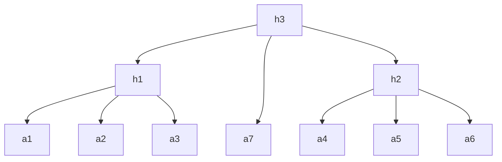
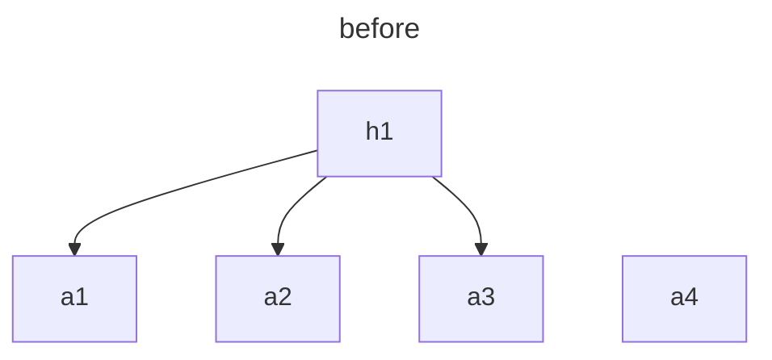
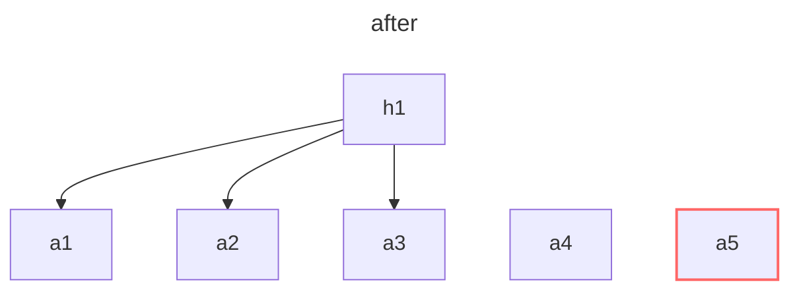
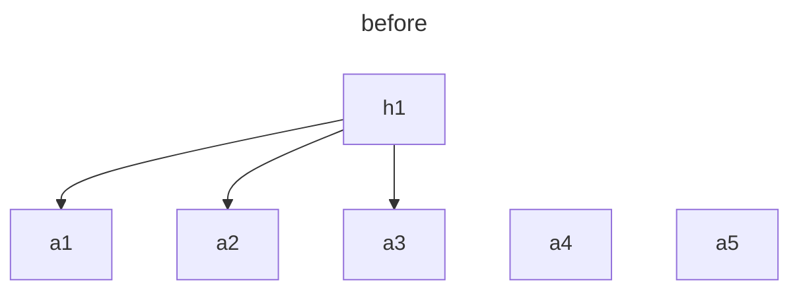
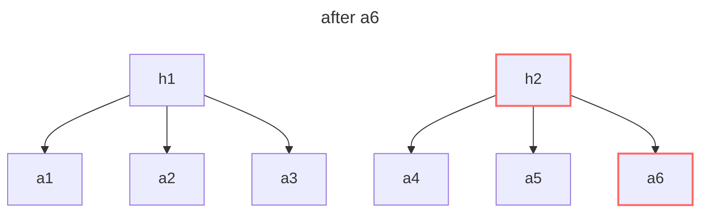
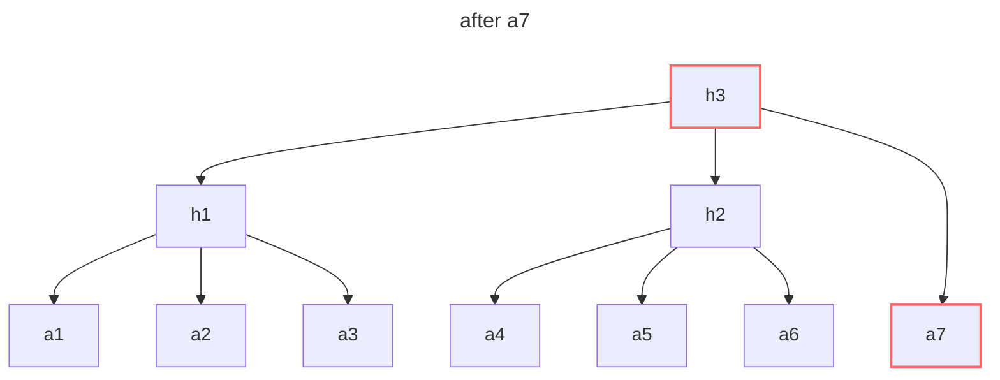

# skew-mmr

skew-MMR is a merkle tree construction that enables efficient membership proofs with very cheap insertion. 

- [rust](./crates/skew-mmr/): Native implementation and arkworks verifier gadget
- [js](./packages/): Native implementation
- [circom](./circuits/): Circom verifier gadget
- [solidity](./contracts/): Solidity accumulator and frontier verifier

## Benchmarks

Comparison with zk-kit's leanIMT and IMT: [bench/](bench/README.md).

## Overview

Example of a skew-MMR:

### Insertion

Insertion assures that only the two rightmost nodes may have the same depth. Because merging involves three nodes, this means that each insertion requires exactly one hash.

#### Case 1: The two rightmost nodes are not the same depth

The new node is `hash(new, 0, 0)` and appended to the list.

When inserting `a5`:

#### Case 2: The two rightmost nodes are the same depth

The two rightmost nodes are popped from the list, hashed with the new node as `hash(new, rightmost, second rightmost)`, and the result is pushed to the list.

When inserting `a6` and `a7`:

