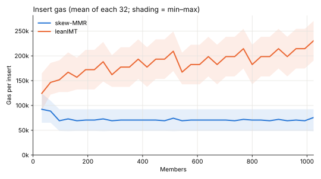
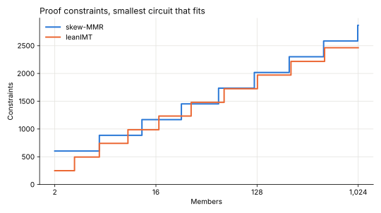
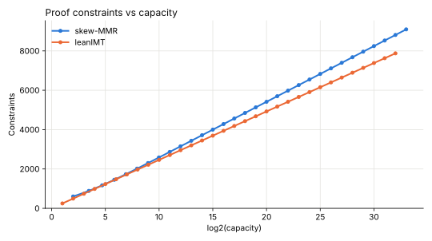
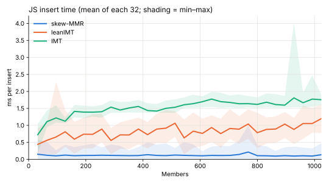

# Skew-MMR Benchmarks

Skew-MMR benchmarks for compute, gas, and constraint compared with zk-kit's [leanIMT](https://github.com/zk-kit/zk-kit.solidity/tree/main/packages/lean-imt) and [IMT](https://github.com/zk-kit/zk-kit/tree/main/packages/imt).

| At 1,024 members           | skew-MMR | leanIMT |
| -------------------------- | -------- | ------- |
| Mean insert gas            | 71,948   | 185,610 |
| Proof constraints          | 2,867    | 2,463   |
| JS insert (ms)             | 0.120    | 0.829   |
| JS verify (ms)             | 1.42     | 1.51    |

## Insert gas

Gas for each insert into an empty tree, as a full transaction.



| Mean over first | skew-MMR | leanIMT |
| --------------- | -------- | ------- |
| 128 members     | 80,762   | 147,418 |
| 256 members     | 75,791   | 159,889 |
| 512 members     | 73,250   | 172,666 |
| 1,024 members   | 71,948   | 185,610 |

Skew-MMR hashes at most once per insert, so its cost stays flat. LeanIMT updates every level, so its cost grows with the number of members.

## Proof constraints

Circom constraints (`--O2`) for skew-MMR's [`inclusion.circom`](../circuits/inclusion.circom) and zk-kit's `binary-merkle-root` (used by leanIMT and IMT). Each size uses the smallest circuit that holds it.



| Members | leanIMT | skew-MMR | Difference |
| ------- | ------- | -------- | ---------- |
| 10      | 987     | 886      | −10%       |
| 100     | 1,725   | 1,735    | +1%        |
| 500     | 2,217   | 2,301    | +4%        |
| 1,000   | 2,463   | 2,584    | +5%        |
| 1,024   | 2,463   | 2,867    | +16%       |



## JS performance

[tinybench](https://github.com/tinylibs/tinybench) over 1,024 iterations using `@zk-kit/imt`, `@zk-kit/lean-imt`, [`packages/`](../packages), and `poseidon-lite`.



| Mean ms       | skew-MMR | leanIMT | IMT    |
| ------------- | -------- | ------- | ------ |
| Insert        | 0.120    | 0.829   | 1.52   |
| GenerateProof | 0.0014   | 0.0029  | 0.0032 |
| VerifyProof   | 1.42     | 1.51    | 1.66   |

## Running

From the repo root, in `nix develop`:

```bash
just bench
```
