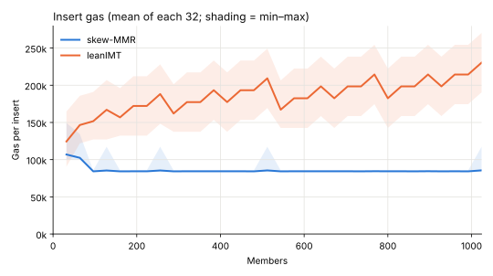
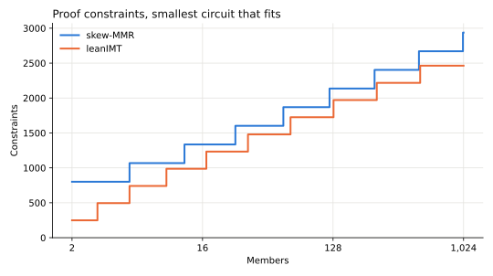
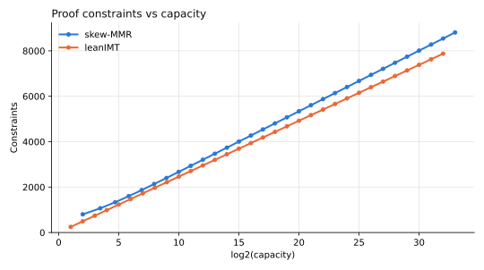
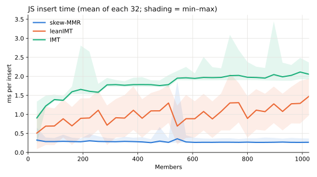

# Skew-MMR Benchmarks

Skew-MMR benchmarks for compute, gas, and constraint compared with zk-kit's [leanIMT](https://github.com/zk-kit/zk-kit.solidity/tree/main/packages/lean-imt) and [IMT](https://github.com/zk-kit/zk-kit/tree/main/packages/imt).

## Insert gas

Gas for each insert into an empty tree, as a full transaction (`forge test --isolate`). Both use the original Poseidon from `poseidon-solidity`: `PoseidonT4` for skew-MMR and `PoseidonT3` for leanIMT.



Skew-MMR hashes once per insert, so its cost stays flat. LeanIMT updates every level, so its cost grows with the number of members.

## Proof constraints

Circom constraints (`--O2`) for skew-MMR's [`inclusion.circom`](../circuits/inclusion.circom) and zk-kit's `binary-merkle-root` (used by leanIMT and IMT). Each size uses the smallest circuit that holds it.





## JS performance

[tinybench](https://github.com/tinylibs/tinybench) over 1,024 iterations using `@zk-kit/imt`, `@zk-kit/lean-imt`, [`packages/`](../packages), and `poseidon-lite`.



## Running

From the repo root, in `nix develop`:

```bash
just bench
```
