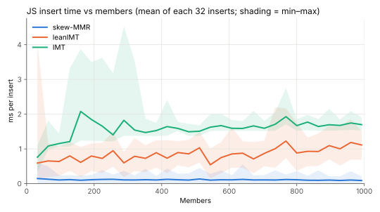
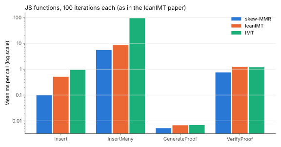

# Skew-MMR vs zk-kit's Merkle trees

Skew-MMR compared with zk-kit's [leanIMT](https://github.com/zk-kit/zk-kit.solidity/tree/main/packages/lean-imt) and [IMT](https://github.com/zk-kit/zk-kit/tree/main/packages/imt), at the scale of the [leanIMT paper](https://github.com/zk-kit/zk-kit/tree/main/papers/leanimt): up to 1,024 members. All hashing uses the original Poseidon, through the same libraries zk-kit uses.

**Summary, over the first 1,024 members:**

- **Insert gas:** skew-MMR averages 53k (keccak) / 72k (Poseidon) and stays flat. LeanIMT averages 90k / 186k and keeps growing.
- **Proof constraints:** for 1,000 members, skew-MMR needs 2,584, 5% more than leanIMT's 2,463.
- **JS:** skew-MMR inserts in 0.11 ms vs leanIMT's 0.85 ms. Verify is 0.75 ms vs 1.22 ms.

## Insert gas

Gas for each of the first 1,024 inserts into an empty tree. Each insert is measured as a full transaction, as zk-kit's gas reports do.


| Average over first | skew-MMR keccak | leanIMT keccak | skew-MMR Poseidon | leanIMT Poseidon |
| ------------------ | --------------- | -------------- | ----------------- | ---------------- |
| 128 members        | 62,236          | 79,468         | 80,762            | 147,418          |
| 256 members        | 57,118          | 82,577         | 75,791            | 159,889          |
| 512 members        | 54,503          | 85,997         | 73,250            | 172,666          |
| 1,024 members      | 53,165          | 89,586         | 71,948            | 185,610          |

Skew-MMR does at most one hash per insert, so its cost doesn't depend on size. Its early inserts cost more because they write storage slots for the first time. LeanIMT updates one node per level, so its cost grows with log2(members).

**Why leanIMT's keccak and Poseidon curves go in opposite directions.** At each level, a leanIMT insert either hashes or writes to storage, depending on that bit of the leaf's index. Right after a power of two, the index is `1000…0`, which means few hashes and many writes. As the index climbs toward the next power of two, the mix shifts back toward hashes.

- **Keccak:** writes are the expensive part, so gas jumps up at each power of two.
- **Poseidon:** hashes are the expensive part, so gas drops at each power of two.

LeanIMT also stores a leaf → index mapping on every insert (~22k gas), which skew-MMR doesn't have.

## Membership-proof constraints

Circom constraint counts (`--O2`):

- **skew-MMR:** [`circuits/inclusion.circom`](../circuits/inclusion.circom).
- **leanIMT:** zk-kit's `binary-merkle-root`, which Semaphore uses. zk-kit uses the same circuit for the binary IMT.


| Capacity | leanIMT | skew-MMR | Difference |
| -------- | ------- | -------- | ---------- |
| 2^10     | 2,463   | 2,584    | +5%        |
| 2^16     | 3,939   | 4,282    | +9%        |
| 2^20     | 4,923   | 5,414    | +10%       |
| 2^24     | 5,907   | 6,546    | +11%       |
| 2^32     | 7,875   | 8,810    | +12%       |

Each level costs leanIMT 246 constraints and skew-MMR 283, mainly because skew-MMR hashes 3 inputs per level instead of 2.

The circuit size is fixed when it's compiled, so the cost depends on the capacity you pick, not on how full the tree is. Here each member count uses the smallest circuit that holds it:


| Members | leanIMT           | skew-MMR          | Difference |
| ------- | ----------------- | ----------------- | ---------- |
| 10      | 987 (depth 4)     | 886 (3 trees)     | −10%       |
| 100     | 1,725 (depth 7)   | 1,735 (6 trees)   | +1%        |
| 500     | 2,217 (depth 9)   | 2,301 (8 trees)   | +4%        |
| 1,000   | 2,463 (depth 10)  | 2,584 (9 trees)   | +5%        |
| 1,024   | 2,463 (depth 10)  | 2,867 (10 trees)  | +16%       |

LeanIMT steps up just after each power of two. Skew-MMR steps up just before it, because `t` trees hold 2^(t+1) − t − 2 members rather than 2^(t+1). So for the last few members before each power of two (63 of the 1,023 sizes here), skew-MMR needs its next size while leanIMT doesn't.

## JS performance

This reproduces the paper's Node.js benchmarks ([imt-benchmarks](https://github.com/vplasencia/imt-benchmarks)): tinybench with the same settings and hooks, and the same `poseidon-lite` hashes. Each iteration adds one member to a growing tree.

**Insert, 1,000 iterations:**



| Mean ms per insert | skew-MMR | leanIMT | IMT   |
| ------------------ | -------- | ------- | ----- |
| 1,000 iterations   | 0.111    | 0.849   | 1.583 |

**All functions, 100 iterations each:**



| Mean ms per call | skew-MMR | leanIMT | IMT     |
| ---------------- | -------- | ------- | ------- |
| Insert           | 0.100    | 0.508   | 0.937   |
| InsertMany       | 5.50     | 8.66    | 94.2    |
| GenerateProof    | 0.0052   | 0.0067  | 0.0069  |
| VerifyProof      | 0.753    | 1.22    | 1.18    |

- **Same setup as the paper:** the IMT is rebuilt one level deeper, untimed, whenever it fills up.
- **InsertMany:** only LeanIMT has a batch insert; skew-MMR and IMT insert in a loop, as the paper does for IMT.
- **Update and Remove** are left out because skew-MMR is append-only.
- **The paper's "Insert vs Members" chart is sorted:** tinybench sorts its samples, so that chart shows insert times from fastest to slowest rather than against the number of members. The chart here times each insert in order.

## Running

From the repo root, in `nix develop`:

```bash
just bench
```

It takes a few minutes. Results are written to `results/`.
