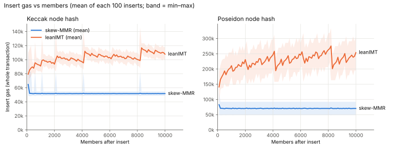
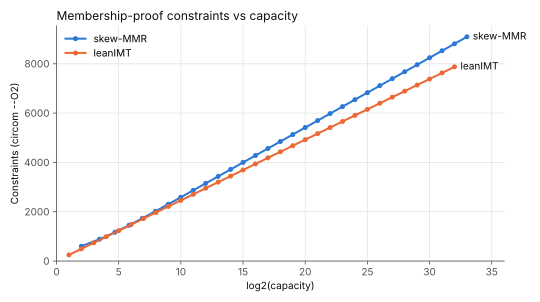
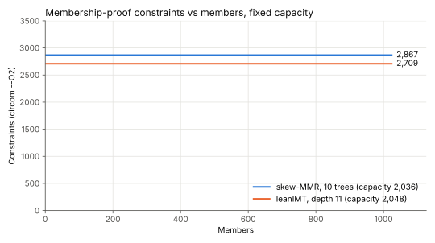
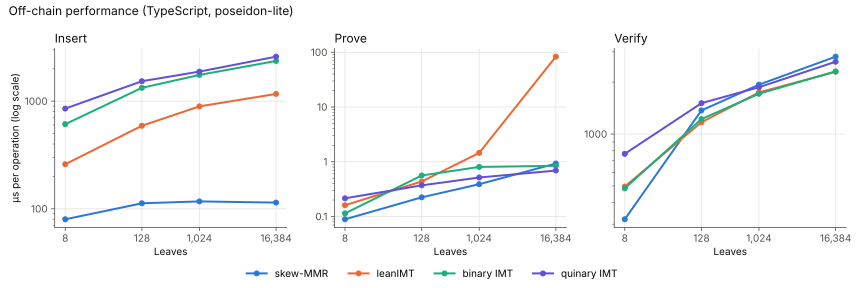

# Skew-MMR vs zk-kit's Merkle trees

Skew-MMR compared with zk-kit's [leanIMT](https://github.com/zk-kit/zk-kit.solidity/tree/main/packages/lean-imt) and [IMT](https://github.com/zk-kit/zk-kit/tree/main/packages/imt). All hashing uses the original Poseidon, through the same libraries zk-kit uses.

**Summary:**

At 100k members:

- **Insert gas:** skew-MMR costs 51.7k (keccak) / 70.6k (Poseidon), flat at every size up to 1M. LeanIMT costs 123k / 269k, and keeps growing.
- **Proof constraints** (capacity 2^17): skew-MMR needs 4,565, about 9% more than leanIMT's 4,185.
- **JS:** skew-MMR inserts in 115 µs vs leanIMT's 1,373 µs. Verify is about the same (~3 ms each).

## Insert gas

Gas per insert, from an empty tree up to 1M members. Each insert is measured as a full transaction, as zk-kit's gas reports do. Every insert is measured up to 10k members. Past that, each point is the 1,000 inserts just before 50k, 100k, 500k and 1M.



| Members | skew-MMR keccak | leanIMT keccak | skew-MMR Poseidon | leanIMT Poseidon |
| ------- | --------------- | -------------- | ----------------- | ---------------- |
| 1k      | 53,105          | 89,676         | 71,775            | 184,428          |
| 10k     | 51,722          | 110,290        | 70,542            | 239,759          |
| 50k     | 51,734          | 118,846        | 70,629            | 260,435          |
| 100k    | 51,734          | 123,386        | 70,554            | 269,315          |
| 500k    | 51,740          | 123,403        | 70,598            | 339,958          |
| 1M      | 51,746          | 128,980        | 70,641            | 342,692          |

(Mean of the 1,000 inserts ending at each size.)

Skew-MMR does at most one hash per insert, so its cost doesn't depend on size. LeanIMT updates one node per level, so its cost grows with log2(members).

**Why leanIMT's keccak and Poseidon curves go in opposite directions.** At each level, a leanIMT insert either hashes or writes to storage, depending on that bit of the leaf's index. Right after a power of two, the index is `1000…0`, which means few hashes and many writes. As the index climbs toward the next power of two, the mix shifts back toward hashes.

- **Keccak:** writes are the expensive part, so gas jumps up at each power of two.
- **Poseidon:** hashes are the expensive part, so gas drops at each power of two.

This also makes leanIMT's number at any single size depend on exactly where you measure. For example, the inserts just before 500k and 1M have mostly-1 index bits. So they hash more than average: high for Poseidon, low for keccak. That's why leanIMT keccak barely moves between 100k and 500k.

LeanIMT also stores a leaf → index mapping on every insert (~22k gas), which skew-MMR doesn't have.

## Membership-proof constraints

Circom constraint counts (`--O2`):

- **skew-MMR:** [`circuits/inclusion.circom`](../circuits/inclusion.circom).
- **leanIMT:** zk-kit's `binary-merkle-root`, which Semaphore uses. zk-kit uses the same circuit for the binary IMT.



| Capacity | leanIMT | skew-MMR | Difference |
| -------- | ------- | -------- | ---------- |
| 2^10     | 2,463   | 2,584    | +5%        |
| 2^16     | 3,939   | 4,282    | +9%        |
| 2^20     | 4,923   | 5,414    | +10%       |
| 2^24     | 5,907   | 6,546    | +11%       |
| 2^32     | 7,875   | 8,810    | +12%       |

Each level costs leanIMT 246 constraints and skew-MMR 283, mainly because skew-MMR hashes 3 inputs per level instead of 2.

Both circuits have a fixed size, so the count doesn't change as the tree fills. Here both are sized for 2^20 (~1M) members:



## JS performance

This follows zk-kit's [JS benchmark](https://github.com/zk-kit/zk-kit/tree/main/benchmarks), with the same libraries, hash and operations, at 1k to 1M leaves. Each tree is built to size, then 1,000 inserts, 1,000 proofs and 1,000 verifies are timed. Times are µs per operation.



| 100k leaves | skew-MMR | leanIMT | binary IMT | quinary IMT |
| ----------- | -------- | ------- | ---------- | ----------- |
| Insert      | 115      | 1,373   | 2,959      | 3,042       |
| Prove       | 1.3      | 438     | 1.5        | 1.0         |
| Verify      | 2,983    | 2,839   | 2,968      | 3,038       |

| 1M leaves | skew-MMR | leanIMT | binary IMT | quinary IMT |
| --------- | -------- | ------- | ---------- | ----------- |
| Insert    | 120      | 1,926   | 3,130      | 3,443       |
| Prove     | 2.2      | 3,527   | 2.2        | 1.8         |
| Verify    | 3,727    | 3,558   | 3,346      | 3,501       |

- **Insert and verify** are dominated by hashing, so they follow the hash counts above.
- **LeanIMT's slow prove** is a zk-kit quirk: each proof copies the whole leaf array.
- **Harness difference:** zk-kit's own harness keeps timing after the work runs out, which inflates its numbers. This one times only real operations.

## Running

From the repo root, in `nix develop`:

```bash
just bench
```

It takes about an hour: ~40 minutes for gas, mostly filling leanIMT to 1M with Poseidon, and ~20 minutes for JS. Results are written to `results/`.
