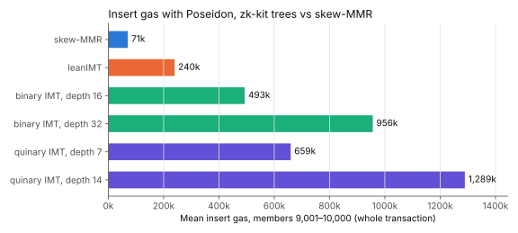

# Skew-MMR vs zk-kit's Merkle trees

Compares the binary skew-MMR (`contracts/`, `circuits/`, `packages/`) with zk-kit's incremental Merkle trees:

- **leanIMT**: [`@zk-kit/lean-imt.sol`](https://github.com/zk-kit/zk-kit.solidity/tree/main/packages/lean-imt), [`@zk-kit/lean-imt`](https://github.com/zk-kit/zk-kit/tree/main/packages/lean-imt), and the [`binary-merkle-root`](https://github.com/zk-kit/zk-kit.circom/tree/main/packages/binary-merkle-root) circuit.
- **Binary and quinary IMT**: [`@zk-kit/imt.sol`](https://github.com/zk-kit/zk-kit.solidity/tree/main/packages/imt) and [`@zk-kit/imt`](https://github.com/zk-kit/zk-kit/tree/main/packages/imt). These are fixed-depth trees padded with zero hashes.

Three measurements:

1. **Insert gas** vs number of members (Solidity).
2. **Membership-proof constraints** vs capacity, and vs members at a fixed capacity (circom).
3. **Off-chain performance** of insert, prove and verify (TypeScript). This mirrors zk-kit's own [benchmarks](https://github.com/zk-kit/zk-kit/tree/main/benchmarks).

Every Poseidon here is the original circomlib Poseidon, not Poseidon2. That means `poseidon-solidity` on-chain, circomlib's `Poseidon(n)` in circuits, and `poseidon-lite` in TypeScript, which are the same libraries zk-kit uses.

## Insert gas

Each of the first 10,000 inserts into an empty structure is measured as its own transaction. Every call in the forge test runs isolated (`isolate = true`), so the figure is whole-transaction gas: the 21,000 base cost, calldata, and cold access to every account and slot touched, including the Poseidon libraries. This is what zk-kit's tests report through `hardhat-gas-reporter`. Raw per-insert data is in `results/gas/*.csv`.



| Structure             | Mean insert gas, members 9,001–10,000 |
| --------------------- | ------------------------------------- |
| skew-MMR              | 70,586                                |
| leanIMT               | 239,737                               |
| binary IMT, depth 16  | 492,941                               |
| binary IMT, depth 32  | 956,297                               |
| quinary IMT, depth 7  | 659,480                               |
| quinary IMT, depth 14 | 1,289,173                             |

The fixed-depth IMTs hash every level on every insert. That's `depth` Poseidon calls per insert: ~30k gas each for `PoseidonT3`, and ~94k for the 5-input `PoseidonT6`. So their cost is flat in the number of members but set by the depth they were created with. Quinary depth 7 (78,125 leaves) and depth 14 (~6.1 × 10⁹) are roughly the capacities of binary depths 16 and 32.

LeanIMT and skew-MMR grow their depth as they fill. Here they are over time, with keccak and Poseidon as the node hash:


| Members | skew-MMR keccak | leanIMT keccak | skew-MMR Poseidon | leanIMT Poseidon |
| ------- | --------------- | -------------- | ----------------- | ---------------- |
| 100     | 64,796          | 79,379         | 82,863            | 140,965          |
| 1,000   | 51,644          | 91,007         | 69,711            | 210,974          |
| 2,500   | 51,766          | 101,768        | 70,586            | 218,743          |
| 5,000   | 51,705          | 105,074        | 70,149            | 234,767          |
| 7,500   | 51,766          | 103,436        | 70,586            | 244,352          |
| 10,000  | 51,766          | 107,833        | 70,586            | 253,986          |

(Mean of the 100 inserts ending at each member count.)

**Skew-MMR is flat.** It hashes at most once per insert, and only every other insert on average. Its spikes come from the first write to a new frontier slot, and from the first 64 inserts filling the history ring.

**LeanIMT grows with `log2(members)`, and its keccak and Poseidon curves move in opposite directions.** The insert walks every level of the tree, and at each level it does one of two things, depending on that bit of the leaf's index:

- **bit = 1:** load the left sibling and **hash** (~2.1k gas plus the hash),
- **bit = 0:** **store** the node as the new left sibling (a nonzero-to-nonzero `SSTORE`, ~5k gas).

Just after a power of two the index is `1000…0`, so the insert does few hashes and many stores, and the tree has also grown a level. As the index climbs toward the next power of two it gains 1-bits, so the inserts do more hashes and fewer stores. Measured across the 8,192 boundary:

| Members     | Hashes per insert | Stores per insert | keccak gas | Poseidon gas |
| ----------- | ----------------- | ----------------- | ---------- | ------------ |
| 7,600–8,192 | 8.57              | 4.43              | 100,242    | 263,041      |
| 8,193–8,700 | 5.47              | 8.53              | 113,899    | 218,762      |

With keccak, a hash costs far less than a store, so the jump to more stores pushes gas **up**, and then it drifts down. With Poseidon (~30k gas per hash), a hash costs far more than a store, so the drop in hashes pulls gas **down**, and then it drifts up.

**Caveat on the comparison:** every leanIMT insert also writes `leaves[leaf] = index`, a zero-to-nonzero `SSTORE` of ~22.1k gas. It's part of zk-kit's design (`has` / `indexOf` and the duplicate check) and Semaphore relies on it. Skew-MMR instead writes its frontier commitment into a 64-slot history ring.

## Membership-proof constraints

Compiled with `circom --O2`, which folds away all linear constraints:

- **skew-MMR:** `SkewMmrInclusion(MAX_TREES)` from [`circuits/inclusion.circom`](../circuits/inclusion.circom), using `Poseidon(3)`.
- **leanIMT:** `BinaryMerkleRoot(MAX_DEPTH)` from `@zk-kit/binary-merkle-root.circom`, using `Poseidon(2)`. This is the circuit Semaphore v4 uses. zk-kit has no separate circuit for the fixed-depth binary IMT, which uses the same one at full depth, so the leanIMT line covers it too.
- **Quinary IMT:** zk-kit publishes no quinary circuit, so it is not measured.


A skew-MMR capped at `t` trees holds `2^(t+1) - t - 2` members. So `t = d - 1` trees falls `d + 1` members short of a depth-`d` leanIMT, and `t = d` holds about twice as many.

| leanIMT depth | leanIMT constraints | skew-MMR, depth − 1 trees | skew-MMR, depth trees |
| ------------- | ------------------- | ------------------------- | --------------------- |
| 10 (2^10)     | 2,463               | 2,584 (+5%)               | 2,867 (+16%)          |
| 16 (2^16)     | 3,939               | 4,282 (+9%)               | 4,565 (+16%)          |
| 20 (2^20)     | 4,923               | 5,414 (+10%)              | 5,697 (+16%)          |
| 24 (2^24)     | 5,907               | 6,546 (+11%)              | 6,829 (+16%)          |
| 32 (2^32)     | 7,875               | 8,810 (+12%)              | 9,093 (+15%)          |

Each extra level costs leanIMT 246 constraints (one `Poseidon(2)` plus a mux). It costs skew-MMR 283 (one `Poseidon(3)`, a switcher and mux, frontier unpacking, and index bookkeeping).


At a fixed capacity, both circuits are padded to their maximum size, so the count does not depend on the number of members. Both lines are flat by construction.

## Off-chain performance (TypeScript)

This follows zk-kit's [`benchmark-merkle-trees.ts`](https://github.com/zk-kit/zk-kit/blob/main/benchmarks/benchmark-merkle-trees.ts):

- **Same setup:** the same libraries and hash (`poseidon2`, `poseidon5` and, for skew-MMR, `poseidon3` from `poseidon-lite`) and the same tree sizes (depths 3, 7, 10, plus 14).
- **Same operations:** insert every leaf, prove a random half of the leaves, verify those proofs. Update and delete are left out because skew-MMR is append-only.
- **Same tree configuration:** binary IMT with depth = log2(leaves), quinary IMT with the smallest depth that fits, leanIMT, and the skew-MMR from [`packages/`](../packages).

One difference: zk-kit's benny harness keeps calling a case after its work runs out. Once every leaf is inserted or verified, the call is a no-op, which inflates ops/sec. This harness instead times a fixed batch of real operations and reports the median µs per operation (`perf/bench.ts`).


| insert (µs/op) | skew-MMR | leanIMT | binary IMT | quinary IMT |
| -------------- | -------- | ------- | ---------- | ----------- |
| 8 leaves       | 80.0     | 259.4   | 611.5      | 853.3       |
| 128 leaves     | 112.6    | 590.9   | 1,330.2    | 1,532.8     |
| 1,024 leaves   | 117.1    | 895.0   | 1,753.4    | 1,882.7     |
| 16,384 leaves  | 114.2    | 1,167.4 | 2,364.2    | 2,591.4     |

| prove (µs/op) | skew-MMR | leanIMT | binary IMT | quinary IMT |
| ------------- | -------- | ------- | ---------- | ----------- |
| 8 leaves      | 0.1      | 0.2     | 0.1        | 0.2         |
| 128 leaves    | 0.2      | 0.4     | 0.6        | 0.4         |
| 1,024 leaves  | 0.4      | 1.5     | 0.8        | 0.5         |
| 16,384 leaves | 0.9      | 83.2    | 0.8        | 0.7         |

| verify (µs/op) | skew-MMR | leanIMT | binary IMT | quinary IMT |
| -------------- | -------- | ------- | ---------- | ----------- |
| 8 leaves       | 320.2    | 496.1   | 484.3      | 767.9       |
| 128 leaves     | 1,371.6  | 1,171.1 | 1,221.6    | 1,511.4     |
| 1,024 leaves   | 1,935.6  | 1,745.5 | 1,714.0    | 1,870.1     |
| 16,384 leaves  | 2,813.9  | 2,301.2 | 2,311.3    | 2,629.7     |

Hashing dominates every operation except `prove`, which only reads stored nodes:

- **Insert:** skew-MMR averages half a hash per insert, so it is 10–20× faster than the others.
- **Verify:** skew-MMR is ~20% slower than leanIMT at 16k leaves. Its path is about as long, and each step hashes 3 inputs instead of 2.
- **LeanIMT `prove` at 16k:** the jump is a zk-kit implementation detail. `generateProof` reads `this.leaves[index]`, and the `leaves` getter returns `this._nodes[0].slice()`, so every proof copies the whole leaf array.

These are implementation benchmarks of four separate TypeScript codebases. Treat them as indicative; the gas and constraint numbers are the structural comparison.

## Running

Inside the repo's dev shell (`nix develop`), from the repo root:

```bash
just bench
```

That runs:

```bash
(cd packages && pnpm install)                  # skew-MMR TS implementation's deps
cd benchmarks
pnpm install                                   # zk-kit packages, poseidon, circom libraries
forge install foundry-rs/forge-std@v1.16.2 --no-git
forge test                                     # results/gas/*.csv (~1 min)
python3 scripts/constraints.py                 # results/constraints.csv
node perf/bench.ts                             # results/perf-js.csv (~15 min, Node >= 23.6)
python3 scripts/plot.py                        # results/*.svg, prints the tables above
```
