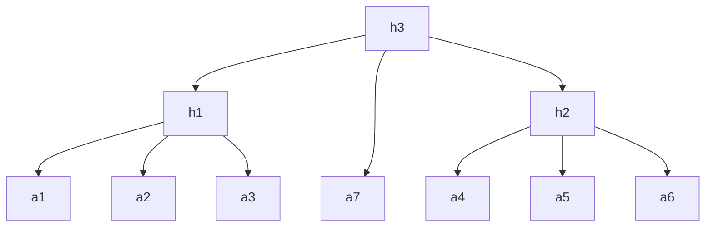
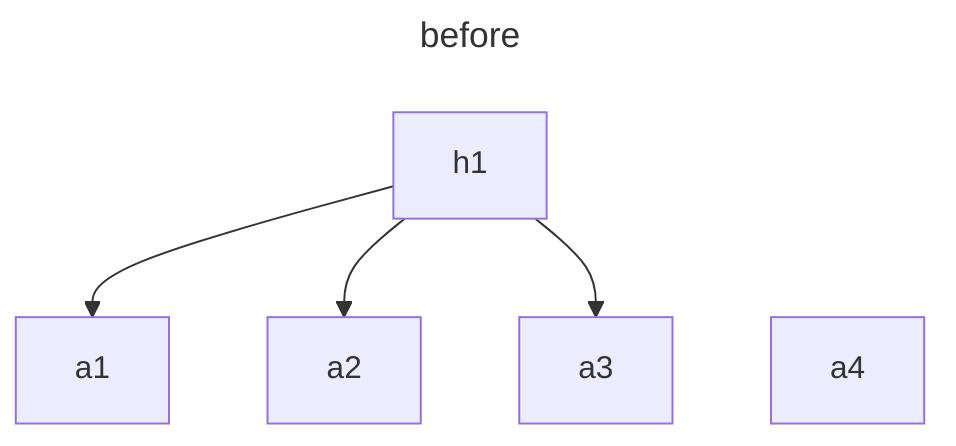
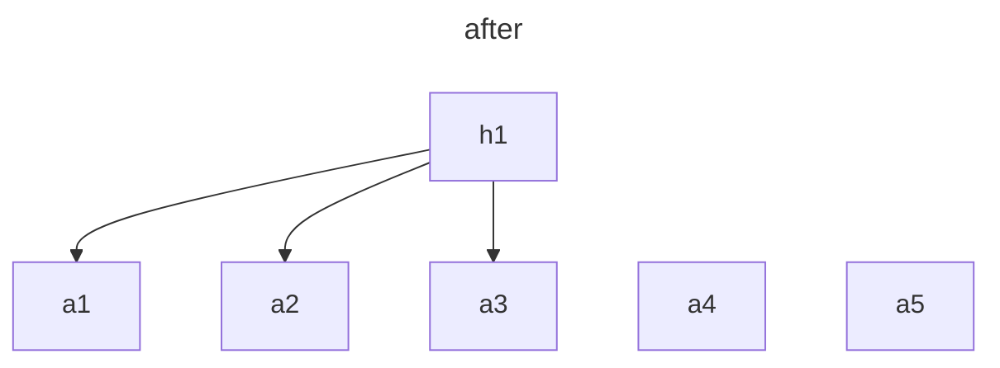
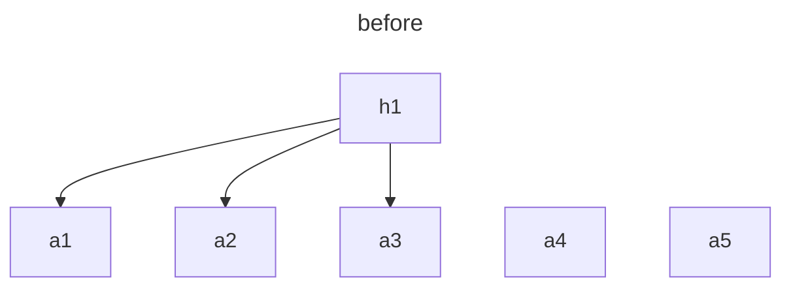
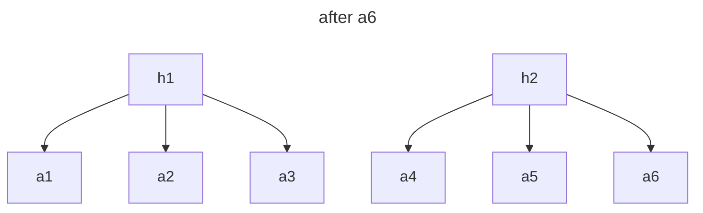
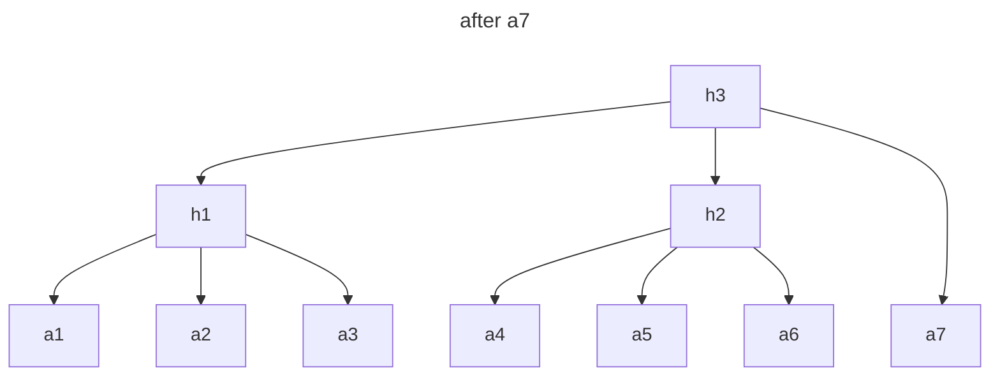

# skew-mmr

The skew-MMR is a list of perfect Merkle trees, similar to a Merkle mountain range, with modified insertion rules that ensure each insertion requires at most one hash.

Example of a skew-MMR:

## Insertion

### Case 1: The two rightmost nodes are not the same depth

The new node is appended to the list without any hashes.

When inserting `a5`:

### Case 2: The two rightmost nodes are the same depth

The two rightmost nodes are popped from the list, hashed with the new node as `hash(new, rightmost, second rightmost)`, and the result is pushed to the list.

When inserting `a6` and `a7`:

